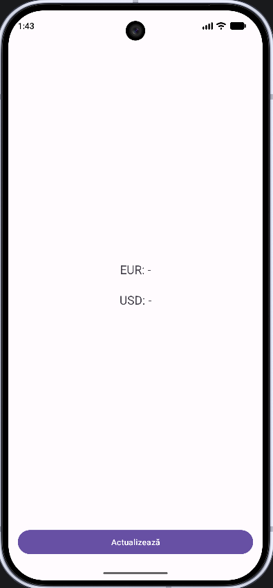

# 06 - Rețea asincronă și XML (curs BNR)

## Obiective

- să creați ecranul `BnrActivity` și să îl deschideți din options menu;
- să înțelegeți de ce operațiile de rețea **nu** rulează pe firul UI și cum separați operațiile de rețea de actualizarea ecranului;
- să declarați permisiunea `INTERNET` și să folosiți HTTPS (fără cleartext);
- să descărcați XML-ul BNR, să îl parsați (DOM) și să afișați cursurile valutare pe ecran, **fără** `AsyncTask`.

## De unde porniți

- Starea de la finalul Seminarului 5 (tag `Seminar_5-grupa1086` sau `Seminar_5-grupa1088`, ori branch-ul grupei: `git pull` sau **Clone Repository** din Android Studio - vezi [README](../README.md)).
- Options menu pe `MainActivity`, cu itemul „Curs BNR” (în Seminarul 5 afișa un Toast). Acum îl legați de Activity-ul pe care îl creați aici.

## 1. Mai întâi ecranul: `BnrActivity`

Vom crea prima oară UI-ul și legătura din meniu, apoi vom adăuga operațiile de rețea.

### 1.1. Crearea Activity-ului

Pe pachetul `ro.ase.semdam` (lângă `MainActivity`): **New → Activity → Empty Views Activity** → nume `BnrActivity`, Language **Java**. Șablonul înregistrează Activity-ul în Manifest și creează `activity_bnr.xml`. View Binding îl adăugați voi în `onCreate`, ca la `AddActivity` / `HostActivity` (`ActivityBnrBinding`).

### 1.2. Layout-ul (`activity_bnr.xml`)

Rădăcina e **ConstraintLayout** cu `android:id="@+id/main"` (pentru insets / EdgeToEdge, ca pe celelalte ecrane). Pe ecran: două `TextView` pentru EUR și USD (text inițial `-`, ca să vedeți că încă nu ați descărcat nimic) și un buton „Actualizează” jos. Cele două texte stau **centrate** pe mijlocul zonei de deasupra butonului, una sub alta, cu spațiu între ele (`layout_marginTop` pe USD + lanț vertical `packed`). Listener-ul butonului îl legați mai târziu, la secțiunea 6.

Exemplu complet:

```xml
<?xml version="1.0" encoding="utf-8"?>
<androidx.constraintlayout.widget.ConstraintLayout
    xmlns:android="http://schemas.android.com/apk/res/android"
    xmlns:app="http://schemas.android.com/apk/res-auto"
    android:id="@+id/main"
    android:layout_width="match_parent"
    android:layout_height="match_parent">

    <TextView
        android:id="@+id/tvEur"
        android:layout_width="wrap_content"
        android:layout_height="wrap_content"
        android:text="EUR: -"
        android:textSize="20sp"
        app:layout_constraintBottom_toTopOf="@id/tvUsd"
        app:layout_constraintEnd_toEndOf="parent"
        app:layout_constraintStart_toStartOf="parent"
        app:layout_constraintTop_toTopOf="parent"
        app:layout_constraintVertical_chainStyle="packed" />

    <TextView
        android:id="@+id/tvUsd"
        android:layout_width="wrap_content"
        android:layout_height="wrap_content"
        android:layout_marginTop="24dp"
        android:text="USD: -"
        android:textSize="20sp"
        app:layout_constraintBottom_toTopOf="@id/btnActualizeaza"
        app:layout_constraintEnd_toEndOf="parent"
        app:layout_constraintStart_toStartOf="parent"
        app:layout_constraintTop_toBottomOf="@id/tvEur" />

    <Button
        android:id="@+id/btnActualizeaza"
        android:layout_width="0dp"
        android:layout_height="wrap_content"
        android:layout_margin="16dp"
        android:text="Actualizează"
        app:layout_constraintBottom_toBottomOf="parent"
        app:layout_constraintEnd_toEndOf="parent"
        app:layout_constraintStart_toStartOf="parent" />

</androidx.constraintlayout.widget.ConstraintLayout>
```

În `BnrActivity.onCreate`, după `EdgeToEdge.enable(this)`: inflate cu `ActivityBnrBinding`, `setContentView(binding.getRoot())` și listener-ul de insets pe `binding.main`, același tipar ca în `MainActivity`.

### 1.3. Deschiderea din meniu (`MainActivity`)

Itemul „Curs BNR” există deja din Seminarul 5: în `res/menu/meniu_principal.xml`, id `action_bnr`. **Nu** modificați meniul XML pentru acest pas.

Modificați **`MainActivity`**, metoda **`onOptionsItemSelected`**: acolo tratați apăsările din overflow. În Seminarul 5, la `R.id.action_bnr` aveați un Toast („Curs BNR: în curând”). **Înlocuiți** corpul acelei ramuri cu deschiderea noului ecran:

```java
if (id == R.id.action_bnr) {
    startActivity(new Intent(this, BnrActivity.class));
    return true;
}
```

Import: `android.content.Intent` (dacă lipsește). Restul ramurilor (`action_despre`, live assignment, `action_fragmente` etc.) rămân neschimbate.

Rulați aplicația: pe `MainActivity`, cele trei puncte → „Curs BNR” → se deschide `BnrActivity` cu EUR/USD pe `-` și butonul jos. Ar trebui să arate așa:



## 2. Thread-ul UI, thread-ul de fundal și ANR

Aplicația desenează ecranul și tratează atingerile utilizatorului pe **thread-ul principal** (main / UI thread). Orice operație lentă pe acest thread (rețea, fișier mare, interogare complexă) blochează interfața. Astfel, dacă faceți una dintre aceste operații pe thread-ul UI, utilizatorul vede un ecran înghețat; sistemul poate afișa dialogul ANR (_Application Not Responding_). Utilizatorul se va frustra și va forța oprirea aplicației. Tocmai de aceea, trebuie să separăm operațiile de rețea de actualizarea ecranului.

Tiparul pe care îl folosiți la oră:

1. cererea HTTP și parsarea XML pe un **executor** (thread de fundal);
2. actualizarea `TextView`-urilor pe thread-ul principal, cu `Handler` legat de `Looper.getMainLooper()`.

Ambele idei de mai jos (API vechi și API actual) fac același lucru: muncă lentă în fundal, UI pe main thread. Diferența e **cum** le scrieți. La oră folosim Executor + Handler. La examen sau în materiale vechi puteți întâlni `AsyncTask`: e deprecated, dar merită să îl recunoașteți. La assignment-uri sau probele practice puteți folosi oricare dintre ele.

### Varianta veche: `AsyncTask`

`AsyncTask` era un helper Android peste `Thread` + `Handler`: o clasă generică `AsyncTask<Params, Progress, Result>` în care:

- `doInBackground(...)` rula pe thread de fundal (rețea, parse);
- `onPostExecute(result)` rula pe thread-ul UI (actualizare TextView);
- opțional `onPreExecute` / `onProgressUpdate` pentru spinner sau progres.

Schelet tipic (doar ca să îl recunoașteți; **nu** îl copiați în proiect):

```java
new AsyncTask<Void, Void, List<CursValutar>>() {
    @Override
    protected List<CursValutar> doInBackground(Void... voids) {
        // rețea + parse — NU actualizați UI aici
        return BnrClient.descarca();
    }

    @Override
    protected void onPostExecute(List<CursValutar> cursuri) {
        // aici ești pe UI thread — setați tvEur / tvUsd ca în secțiunea 6
    }
}.execute();
```

Din **API 30**, `AsyncTask` e **deprecated**. Documentația oficială o spune pe scurt: a fost gândit ca ajutor ușor pentru UI, dar cazul cel mai frecvent (task legat de Activity) ducea la **scurgeri de Context**, **callback-uri ratate** sau **crash** la schimbarea de configurație (rotație: Activity recreat, task-ul vechi încă ținea referința). Comportamentul a variat între versiuni de platformă; excepțiile din `doInBackground` puteau fi **înghițite**; iar față de un `Executor` folosit direct, utilitatea e mică. Pool-urile globale (`SERIAL_EXECUTOR`, `THREAD_POOL_EXECUTOR`) nu se potriveau tuturor tipurilor de muncă (rețea vs CPU).

### Varianta actuală: `Executor` + `Handler`

Pachetul standard `java.util.concurrent` vă dă control explicit. Nu mai moșteniți o clasă specială Android: separați „ce rulează în fundal” de „ce revine pe UI”.

#### Piesele

| Piesă                 | Rol                                                                                                                                        |
| --------------------- | ------------------------------------------------------------------------------------------------------------------------------------------ |
| **`Executor`**        | Interfață: „execută acest `Runnable`”. Nu spune _cum_ (thread nou, pool, același thread).                                                  |
| **`ExecutorService`** | Extinde `Executor`: pool gestionat, `execute` / `submit`, plus `shutdown` / `shutdownNow`. **Nu** e legat de componenta Android `Service`. |
| **`Executors`**       | Fabrică de pool-uri gata configurate: `newSingleThreadExecutor()`, `newFixedThreadPool(n)`, etc.                                           |
| **`Looper`**          | Bucla de mesaje a unui thread. Main thread-ul are deja una: `Looper.getMainLooper()`.                                                      |
| **`Handler`**         | Trimite `Runnable` / mesaje în coada unui `Looper`. Cu `new Handler(Looper.getMainLooper())` + `post(...)` ajungeți pe UI.                 |

La oră: un `ExecutorService` pentru rețea + un `Handler` pe main pentru `setText` / Toast. Codul e în secțiunea 6.

#### Cum se leagă

1. `executor.execute(() -> { ... })` pune munca (HTTP, parse) pe un thread din pool.
2. Din acel thread **nu** apelați direct `binding.tvEur.setText(...)`: toolkit-ul UI **nu** e thread-safe ([Processes and threads](https://developer.android.com/guide/components/processes-and-threads)).
3. `mainHandler.post(() -> { ... })` înregistrează actualizarea pe coada main thread-ului; când main e liber, rulează lambda-ul.

Alternative pe UI (aceeași idee): `runOnUiThread(...)`, `view.post(...)`. `Handler` + `Looper.getMainLooper()` e tiparul general pe care îl folosiți în laborator.

Constructorul `new Handler()` **fără** `Looper` e deprecated: legați explicit looper-ul (`new Handler(Looper.getMainLooper())`).

#### Good practices (pe scurt)

- **Nu blocați main thread-ul** cu rețea sau parse grele; altfel riscați ANR.
- **Nu actualizați UI din thread-ul de fundal.**
- **Reutilizați pool-ul**: crearea de thread-uri e costisitoare. Documentația recomandă un pool creat o dată (ex. la nivel de aplicație) și reutilizat;
- Alegeți tipul de pool după muncă: `newSingleThreadExecutor()` (o cerere după alta, ca la butonul Actualizează) vs `newFixedThreadPool(n)` (mai multe task-uri în paralel). Evitați `new Thread(...).start()` la fiecare click.
- **Opriți pool-ul** când nu mai e nevoie (`shutdown()`), ca să nu rămână thread-uri zombie. La seminar, dacă executorul trăiește cât Activity-ul, e suficient să știți ideea; în aplicații reale legați oprirea de ciclul de viață.
- Prindeți excepțiile din fundal și raportați-le pe UI cu `post` (Toast), ca în secțiunea 6; nu lăsați erorile „înghițite” pe thread-ul worker.
- În proiecte mai mari: ViewModel + (Kotlin) coroutines / injectarea unui `Executor` partajat. Pentru un GET la click, Executor + Handler e potrivit; **WorkManager** e pentru muncă persistată care trebuie să supraviețuiască închiderii app.

|                   | `AsyncTask`                                    | `Executor` + `Handler`                          |
| ----------------- | ---------------------------------------------- | ----------------------------------------------- |
| Unde e munca grea | `doInBackground`                               | `executor.execute(() -> { ... })`               |
| Unde e UI         | `onPostExecute` (automat pe main)              | `mainHandler.post(() -> { ... })` (explicit)    |
| Tip               | clasă Android generică, legată des de Activity | API Java standard (`java.util.concurrent`)      |
| Status în SDK     | **deprecated** din API 30                      | recomandat                                      |
| Probleme tipice   | leak Context, rotație, excepții înghițite      | voi decideți ciclul de viață / când opriți pool |

Documentație:

- [AsyncTask](https://developer.android.com/reference/android/os/AsyncTask) (deprecated; citiți nota de deasupra clasei)
- [Asynchronous work with Java threads](https://developer.android.com/develop/background-work/background-tasks/asynchronous/java-threads)
- [Processes and threads overview](https://developer.android.com/guide/components/processes-and-threads)
- [Executor](https://developer.android.com/reference/java/util/concurrent/Executor) / [ExecutorService](https://developer.android.com/reference/java/util/concurrent/ExecutorService) / [Executors](https://developer.android.com/reference/java/util/concurrent/Executors)
- [Handler](https://developer.android.com/reference/android/os/Handler) / [Looper](https://developer.android.com/reference/android/os/Looper)

## 3. XML, HTTPS și permisiunea INTERNET

**XML** (eXtensible Markup Language) e un format text ierarhic: rădăcină, noduri și atribute. BNR publică cursul valutar ca fișier XML. **Parsarea DOM (Document Object Model)** (adică transformarea XML-ului într-un arbore de obiecte) se face cu `DocumentBuilderFactory` → `DocumentBuilder` → `parse`.

**Permisiunile** din Manifest anunță sistemului ce capacități cere aplicația. Fără permisiunea `INTERNET`, conexiunea eșuează, chiar dacă telefonul are Wi‑Fi.

În `AndroidManifest.xml`, **în afara** elementului `<application>` și, de preferabil, înaintea sa (e o convenție standard, pentru a vedea de la bun început ce permisiuni are aplicația):

```xml
<uses-permission android:name="android.permission.INTERNET" />
```

Pentru seminarul acesta vă trebuie **doar** permisiunea `INTERNET`. Alte capacități se declară la fel, cu câte un `<uses-permission>`, când aplicația chiar le folosește. Android le grupează (pe scurt) în:

- **la instalare** (_normal_): se acordă odată cu instalarea, fără dialog la rulare. Exemplu: `INTERNET`.
- **la rulare** (_dangerous_ / runtime): din API 23 trebuie cerute explicit în cod (dialog către utilizator), pe lângă linia din Manifest. Exemple: cameră, locație, contacte, notificări (API 33+).

Câteva permisiuni întâlnite des:

| Permisiune                                         | La ce servește (pe scurt)                                                   | Tip tipic            |
| -------------------------------------------------- | --------------------------------------------------------------------------- | -------------------- |
| `INTERNET`                                         | sockect-uri de rețea (HTTP/HTTPS)                                           | instalare            |
| `ACCESS_NETWORK_STATE`                             | verificați dacă există conexiune (fără a deschide socket-ul)                | instalare            |
| `CAMERA`                                           | acces la cameră                                                             | rulare               |
| `ACCESS_COARSE_LOCATION` / `ACCESS_FINE_LOCATION`  | locație aproximativă / precisă                                              | rulare               |
| `READ_CONTACTS` / `WRITE_CONTACTS`                 | citire / scriere contacte                                                   | rulare               |
| `POST_NOTIFICATIONS`                               | afișare notificări (Android 13 / API 33+)                                   | rulare               |
| `READ_EXTERNAL_STORAGE` / `WRITE_EXTERNAL_STORAGE` | stocare externă (pe versiuni mai noi de API, modelul de acces s-a schimbat) | rulare / condiționat |

Lista completă a constantelor e în `android.Manifest.permission`. Nu declarați permisiuni pe care nu le folosiți: magazinele și utilizatorii le văd, iar pe magazinul Google Play pot influența filtrarea dispozitivelor (ex. `CAMERA` sugerează că e nevoie de cameră, ceea ce poate duce la refuz de instalare).

Documentație:

- [Permissions on Android](https://developer.android.com/guide/topics/permissions/overview)
- [Declare app permissions](https://developer.android.com/training/permissions/declaring)
- [\<<uses-permission\>>](https://developer.android.com/guide/topics/manifest/uses-permission-element)
- [Manifest.permission](https://developer.android.com/reference/android/Manifest.permission)

HTTPS criptează traficul. Cleartext HTTP e, în mod implicit, restricționat de la API 28. URL-ul BNR e HTTPS: nu aveți nevoie de excepții cleartext adăugate manual.

## 4. URL-ul cursului BNR

De aici luați datele despre **cursul valutar de azi** (XML publicat de BNR):

```text
https://curs.bnr.ro/nbrfxrates.xml
```

Deschideți adresa și în browser. Structura relevantă: `Cube` (cu atribut `date`), apoi elemente `Rate` cu atribut `currency` și valoarea în textul nodului. Exemplu de răspuns:

```xml
<DataSet xmlns="https://www.bnr.ro/xsd"
    xmlns:xsi="http://www.w3.org/2001/XMLSchema-instance"
    xsi:schemaLocation="https://curs.bnr.ro/xsd/nbrfxrates.xsd">
    <Header>
        <Publisher>National Bank of Romania</Publisher>
        <PublishingDate>2026-10-13</PublishingDate>
        <MessageType>DR</MessageType>
    </Header>
    <Body>
        <Subject>Reference rates</Subject>
        <OrigCurrency>RON</OrigCurrency>
        <Cube date="2026-10-13">
            <Rate currency="AED">1.3000</Rate>
            <Rate currency="AUD">3.3283</Rate>
            <Rate currency="BRL">0.9574</Rate>
            <Rate currency="CAD">3.3484</Rate>
            <Rate currency="CHF">5.7316</Rate>
            <Rate currency="CNY">0.7132</Rate>
            <Rate currency="CZK">0.2191</Rate>
            <Rate currency="DKK">0.7139</Rate>
            <Rate currency="EGP">0.0904</Rate>
            <Rate currency="EUR">5.3370</Rate>
            <Rate currency="GBP">6.3193</Rate>
            <Rate currency="HKD">0.6084</Rate>
            <Rate currency="HUF" multiplier="100">1.4653</Rate>
            <Rate currency="IDR" multiplier="100">0.0267</Rate>
            <Rate currency="ILS">1.5526</Rate>
            <Rate currency="INR">0.0501</Rate>
            <Rate currency="ISK" multiplier="100">3.9185</Rate>
            <Rate currency="JPY" multiplier="100">3.0206</Rate>
            <Rate currency="KRW" multiplier="100">0.3566</Rate>
            <Rate currency="MDL">0.2654</Rate>
            <Rate currency="MXN">0.2614</Rate>
            <Rate currency="MYR">1.1686</Rate>
            <Rate currency="NOK">0.4996</Rate>
            <Rate currency="NZD">2.6763</Rate>
            <Rate currency="PHP">0.0761</Rate>
            <Rate currency="PLN">1.2187</Rate>
            <Rate currency="RSD">0.0455</Rate>
            <Rate currency="RUB">0.0570</Rate>
            <Rate currency="SEK">0.4774</Rate>
            <Rate currency="SGD">3.7303</Rate>
            <Rate currency="THB">0.1423</Rate>
            <Rate currency="TRY">0.0966</Rate>
            <Rate currency="UAH">0.1059</Rate>
            <Rate currency="USD">4.7748</Rate>
            <Rate currency="XAU">642.8367</Rate>
            <Rate currency="XDR">6.4567</Rate>
            <Rate currency="ZAR">0.2895</Rate>
        </Cube>
    </Body>
</DataSet>
```

Pentru laboratorul nostru, căutați în listă `currency="EUR"` și `currency="USD"`. Unele `Rate` au și `multiplier` (ex. `HUF`, `JPY`), deoarece monedele cu valori mici sunt scrise cu `multiplier` (ex. 100 pentru JPY).

## 5. Model și client

Organizați curat codul. Pe `ro.ase.semdam`: **New → Package** → `retea`, apoi **New → Java Class** → `ClientHttp`. Încă un pachet, `bnr`, cu **ambele** clase `CursValutar` și `BnrClient`. Nu le puneți lângă Activity-uri sau în `domeniu`.

`ClientHttp` face doar cererea GET și întoarce corpul ca `String`. `BnrClient` cunoaște XML-ul BNR: elementele `Rate` și atributul `currency`. Parsarea rămâne lângă formatul pe care îl citiți, nu în clasa de rețea.

### `CursValutar`

Clasă simplă cu două atribute: `moneda` și `valoare` (plus constructor și getter-e, ca la modelul din seminariile anterioare):

```java
package ro.ase.semdam.bnr;

public class CursValutar {
    private final String moneda;
    private final double valoare;

    public CursValutar(String moneda, double valoare) {
        this.moneda = moneda;
        this.valoare = valoare;
    }

    public String getMoneda() { return moneda; }
    public double getValoare() { return valoare; }
}
```

### `ClientHttp`

```java
package ro.ase.semdam.retea;

import java.io.BufferedReader;
import java.io.InputStreamReader;
import java.net.HttpURLConnection;
import java.net.URL;
import java.nio.charset.StandardCharsets;

public final class ClientHttp {

    private ClientHttp() { }

    public static String citeste(String adresa) throws Exception {
        HttpURLConnection conexiune = null;
        try {
            URL url = new URL(adresa);
            conexiune = (HttpURLConnection) url.openConnection();
            // setam timeout-urile pentru connect și read, altfel așteptăm la infinit
            conexiune.setConnectTimeout(10_000);
            conexiune.setReadTimeout(10_000);
            conexiune.setRequestMethod("GET");

            try (BufferedReader reader = new BufferedReader(
                    new InputStreamReader(conexiune.getInputStream(), StandardCharsets.UTF_8))) {
                StringBuilder text = new StringBuilder();
                String linie;
                while ((linie = reader.readLine()) != null) {
                    text.append(linie);
                }
                return text.toString();
            }
        } finally {
            if (conexiune != null) {
                conexiune.disconnect();
            }
        }
    }
}
```

`getInputStream()` întoarce corpul răspunsului ca octeți. `InputStreamReader` îi decodează în caractere cu UTF-8. `BufferedReader` citește pe rânduri: `readLine()` întoarce linia următoare, sau `null` când fluxul s-a terminat. Buclele adună liniile în `StringBuilder`. `readLine()` nu păstrează sfârșitul de linie. Pentru XML-ul BNR nu contează: parser-ul nu se uită la spațiile dintre etichete.

`try` cu paranteze închide reader-ul la ieșire. `disconnect()` eliberează conexiunea.

Pe Java 9 există `InputStream.readAllBytes()`, care citește tot fluxul într-un singur apel. Pe Android metoda e abia din API 33, iar desugaring-ul din proiect nu o aduce pe `minSdk` 24. De aceea rămâneți la `BufferedReader`.

### `BnrClient`

`descarca()` cere textul de la `ClientHttp`, apoi:

1. `DocumentBuilderFactory` → `DocumentBuilder` → `parse` pe acel text;
2. căutarea elementelor `Rate` și a atributului `currency`.

```java
package ro.ase.semdam.bnr;

import java.io.StringReader;
import java.util.ArrayList;
import java.util.List;

import javax.xml.parsers.DocumentBuilderFactory;

import org.w3c.dom.Document;
import org.w3c.dom.Element;
import org.w3c.dom.NodeList;
import org.xml.sax.InputSource;

import ro.ase.semdam.retea.ClientHttp;

public final class BnrClient {

    private static final String URL_BNR = "https://curs.bnr.ro/nbrfxrates.xml";

    private BnrClient() { }

    public static List<CursValutar> descarca() throws Exception {
        String xml = ClientHttp.citeste(URL_BNR);
        try (StringReader reader = new StringReader(xml)) {
            Document document = DocumentBuilderFactory.newInstance()
                    .newDocumentBuilder()
                    .parse(new InputSource(reader));
            return extrageRate(document);
        }
    }

    private static List<CursValutar> extrageRate(Document document) {
        List<CursValutar> rezultat = new ArrayList<>();
        NodeList noduri = document.getElementsByTagName("Rate");
        for (int i = 0; i < noduri.getLength(); i++) {
            Element element = (Element) noduri.item(i);
            String moneda = element.getAttribute("currency");
            String textValoare = element.getTextContent().trim();
            if (moneda.isEmpty() || textValoare.isEmpty()) {
                continue;
            }
            double valoare = Double.parseDouble(textValoare);
            rezultat.add(new CursValutar(moneda, valoare));
        }
        return rezultat;
    }
}
```

`getElementsByTagName("Rate")` întoarce toate nodurile `Rate`. Pentru fiecare: atributul `currency` → moneda, textul din nod → valoarea numerică. Pe ecran (secțiunea 6) filtrați din listă EUR și USD; clientul poate păstra toate monedele din feed. `multiplier` îl ignorați aici (nu e nevoie pe EUR/USD).

Documentație: [Connect to the network](https://developer.android.com/develop/connectivity/network-ops/connecting), [HttpURLConnection](https://developer.android.com/reference/java/net/HttpURLConnection)

## 6. Butonul Actualizează în `BnrActivity`

În `BnrActivity`, importați din pachetul nou:

```java
import ro.ase.semdam.bnr.BnrClient;
import ro.ase.semdam.bnr.CursValutar;
```

În `onCreate`, după binding:

```java
ExecutorService executor = Executors.newSingleThreadExecutor();
Handler mainHandler = new Handler(Looper.getMainLooper());

binding.btnActualizeaza.setOnClickListener(v -> {
    binding.btnActualizeaza.setEnabled(false);
    executor.execute(() -> {
        try {
            List<CursValutar> cursuri = BnrClient.descarca();
            mainHandler.post(() -> {
                for (CursValutar curs : cursuri) {
                    if ("EUR".equals(curs.getMoneda())) {
                        binding.tvEur.setText("EUR: " + curs.getValoare());
                    } else if ("USD".equals(curs.getMoneda())) {
                        binding.tvUsd.setText("USD: " + curs.getValoare());
                    }
                }
            });
        } catch (Exception e) {
            mainHandler.post(() -> {
                Toast.makeText(this, "Eroare rețea: " + e.getMessage(), Toast.LENGTH_LONG).show();
            });
        }
        finally {
            mainHandler.post(() -> binding.btnActualizeaza.setEnabled(true));
        }
    });
});
```

Pe main thread, după descărcare, parcurgeți lista și completați `tvEur` / `tvUsd` când găsiți monedele respective. Emulatorul sau telefonul trebuie să aibă internet.

Citiți exemplul împreună cu secțiunea 2: `execute` = fundal, `post` = UI, `finally` + `post` reactivează butonul indiferent de succes/eroare. Păstrați `executor` și `mainHandler` ca **câmpuri** (sau locale în `onCreate`, dar **nu** recreați un `newSingleThreadExecutor()` la fiecare click). Opțional, în `onDestroy`: `executor.shutdown();` ca pool-ul să nu rămână după ce ecranul dispare.

## Verificare

- [ ] `BnrActivity` se deschide din meniu; layout-ul are TextView-uri și buton.
- [ ] `ClientHttp` e în pachetul `ro.ase.semdam.retea`; `CursValutar` și `BnrClient` sunt în `ro.ase.semdam.bnr`.
- [ ] Fără `INTERNET` în Manifest, operația eșuează previzibil.
- [ ] Cu rețea, EUR (și USD) apar pe ecran după Actualizează.
- [ ] Interfața nu rămâne blocată pe durata cererii.
- [ ] URL-ul folosit e `https://curs.bnr.ro/nbrfxrates.xml`.
- [ ] Puteți explica pe scurt de ce `AsyncTask` e deprecated și cum îl înlocuiește `Executor` + `Handler`.

## Bibliografie

- [Connect to the network](https://developer.android.com/develop/connectivity/network-ops/connecting)
- [Asynchronous work with Java threads](https://developer.android.com/develop/background-work/background-tasks/asynchronous/java-threads)
- [Processes and threads overview](https://developer.android.com/guide/components/processes-and-threads)
- [Executor](https://developer.android.com/reference/java/util/concurrent/Executor) · [ExecutorService](https://developer.android.com/reference/java/util/concurrent/ExecutorService) · [Executors](https://developer.android.com/reference/java/util/concurrent/Executors)
- [Handler](https://developer.android.com/reference/android/os/Handler) · [Looper](https://developer.android.com/reference/android/os/Looper)
- [AsyncTask](https://developer.android.com/reference/android/os/AsyncTask)
- [Permissions on Android](https://developer.android.com/guide/topics/permissions/overview)
- [Declare app permissions](https://developer.android.com/training/permissions/declaring)
- [Manifest.permission](https://developer.android.com/reference/android/Manifest.permission)
- [Curs valutar BNR (XML)](https://curs.bnr.ro/nbrfxrates.xml)

## Indexul ghidurilor

| Fișier                                                                     | Temă                                    |
| -------------------------------------------------------------------------- | --------------------------------------- |
| [01-proiect-activity-view-binding.md](01-proiect-activity-view-binding.md) | Proiect, Activity, View Binding, Intent |
| [02-formular-si-model.md](02-formular-si-model.md)                         | Formular, controale, model (POJO)       |
| [03-validare-activity-result.md](03-validare-activity-result.md)           | Validare, Activity Result API           |
| [04-lista-crud-memorie.md](04-lista-crud-memorie.md)                       | ListView, CRUD în memorie               |
| [05-adapter-meniu-fragmente.md](05-adapter-meniu-fragmente.md)             | Adapter personalizat, meniu, fragmente  |
| [06-retea-xml-bnr.md](06-retea-xml-bnr.md)                                 | Rețea asincronă, XML BNR                |
| [07-json-sharedpreferences.md](07-json-sharedpreferences.md)               | JSON, SharedPreferences                 |
| [08-proba1.md](08-proba1.md)                                               | Proba practică 1                        |
| [09-room.md](09-room.md)                                                   | Room (SQLite)                           |
| [10-firebase.md](10-firebase.md)                                           | Firebase Realtime Database              |
| [11-grafica-canvas.md](11-grafica-canvas.md)                               | Grafică 2D pe Canvas                    |
| [12-proba2.md](12-proba2.md)                                               | Proba practică 2                        |
| [13-recapitulare-publicare.md](13-recapitulare-publicare.md)               | Recapitulare, hărți (demo), publicare   |
